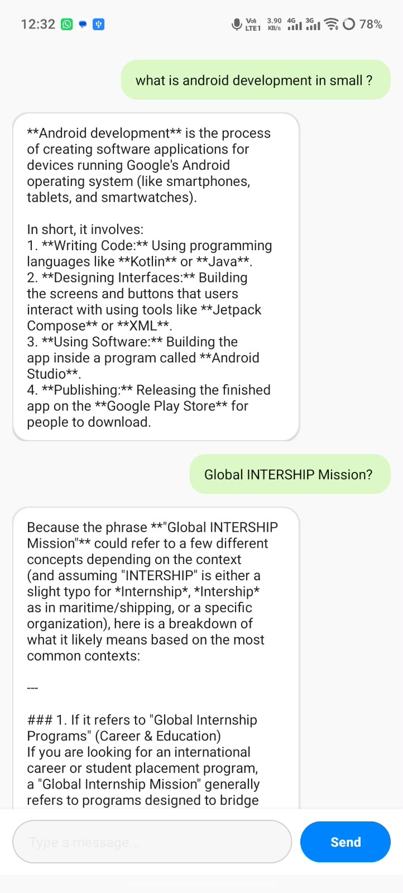

# Android Development Internship - GIM Project

This repository contains the core Android application developed during the internship, featuring multiple utility tools and modern UI components built with Kotlin and Jetpack.

## 📱 App Interface Preview

  

## ✨ Features Included
1. **Gemini AI Chatbot:**
   - Powered by Google Generative AI (`gemini-1.5-flash`).
   - WhatsApp-style clean messaging UI with rounded chat bubbles.
   - Real-time communication on background coroutines (`Dispatchers.IO`).

2. **Modern Calculator:**
   - Fully functional calculator UI and logic supporting arithmetic operations, backspace, and clear functions.

3. **Professional Profile / LinkedIn View:**
   - Clean profile cards and custom layouts.

## 🛠️ Tech Stack & Libraries
- **Language:** Kotlin
- **UI Components:** ConstraintLayout, RecyclerView, Material Components, CardView
- **AI Integration:** Google Generative AI SDK (`com.google.ai.client.generativeai`)
- **Concurrency:** Kotlin Coroutines
